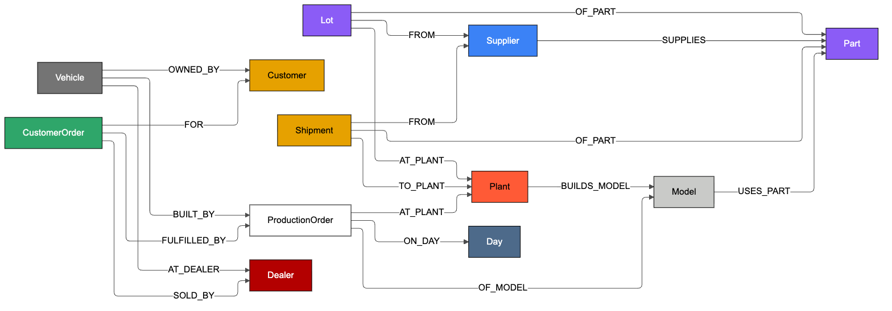

# Wacky Wheels Control Tower

Event-driven multi-agent operations control tower for the **Hack the Highway** datathon (Hitachi Digital Services).
A coordinator and three specialist LLM agents read messy operational events, traverse a knowledge graph of the company with plain-code tools,
rehearse every corrective action on a digital twin, and execute it through an MCP client against the mock enterprise server.
**Agents reason and orchestrate; tools compute; the twin proves; MCP executes.**

> **Status: v2 (branch `v2`), documentation draft.** The architecture sections below follow `docs/PLAN_V2.md`; every figure marked `TODO(v2 final run)` is filled in from the v2 final run.
> The v1 pipeline with deterministic specialists is tag `final-run-2` on `main` (15/15 clean, 797 calls, 0 failed, $0.0498).

| Folder | What |
|---|---|
| `hack_the_highway/` | **Given by the organizers, never modified**: data tables, policy handbook, events, mock enterprise server, brief |
| `src/control_tower/` | Our pipeline: data loader, knowledge graph, understanding, agents, twin, MCP server, schemas |
| `api/` | FastAPI backend for the UI (traces, actions, graph, KPIs, live SSE stream) |
| `ui/` | React control-tower UI |
| `eval/` | Oracle, replay grader, paraphrase robustness bench |
| `docs/` | `SPEC.md` (what), `PLAN.md` (how), `WORKPLAN.md` (who/when), `ONBOARDING.md` (how we work), `BRAND.md`, `CONCEPTS.md`, `contracts.md` |
| `traces/examples/` | Hand-written example traces the UI is built against |

## Run the pipeline

```bash
# 1. a fresh enterprise server (the world restarts empty each time it starts)
uv run python hack_the_highway/enterprise_server.py --data hack_the_highway/data \
  --events hack_the_highway/data/events.json --out runs/dev --port 8000 --overwrite
# 2. all 15 events (needs GEMINI_API_KEY in .env; every LLM response is live)
uv run python -m control_tower.run --all --out runs/dev
# 3. grade the server's log on a fresh copy of the world against an independent oracle
uv run python eval/replay_grader.py runs/dev/action_log.jsonl --traces traces/dev
```

Dry run with no server (the in-process twin plays the enterprise; the LLM is still called live):

```bash
uv run python -m control_tower.run --all --dry-run --out runs/dev
```

Real traces of the final run are in `traces/final/` (also the UI default via `traces/snapshot/`).

## Setup

```bash
uv sync
uv run python hack_the_highway/enterprise_server.py --data hack_the_highway/data --events hack_the_highway/data/events.json --out runs/dev --port 8000 --overwrite
uv run pytest
```

## Architecture

```
event ─▶ COORDINATOR (LLM agent, hub) ──delegate──▶ SUPPLY CHAIN PLANNER      (LLM agent)
         understand · resolve · gate     ──────────▶ DEALER NETWORK            (LLM agent)
         delegate · validate · execute   ──────────▶ CUSTOMER CARE & QUALITY  (LLM agent)
         explain · escalate to a human         each agent calls plain-code tools (graph, planners, composers)
              └─▶ validators (handbook as code) ─▶ twin rehearsal ─▶ auditor (2nd model) ─▶ MCP client ─▶ enterprise server
```

Hub and spoke: specialists never call each other; every hand-off goes through the coordinator, is validated and is recorded. The **Orchestration** tab of the UI
shows every agent turn, tool call and message live.

## LLM versus code

| LLM agents (reasoning, recorded turn by turn) | Plain code (tools and validators) |
|---|---|
| read the event, categorise it, split compound messages | name → id resolution, relative dates from 2027-03-08, snapping to real ETAs and lot windows |
| gate: noise, unconfirmed, or confirmed | graph traversal and the affected sets |
| choose which specialist to delegate to and with what task | slot planning, loaner ranking, notice and stop-sale composition |
| explain the result; a second model audits the plan | handbook rules 1–10 as validators, twin rehearsal, MCP execution, failed-call handling |

No LLM response is cached: every one is live. The numbers that change the world come from tools and are checked by validators.

## Guardrails

- Validators recompute the expected plan through the graph; a failed validator sends the plan back to the specialist, and after two failed rounds the incident is escalated (no silent fallback to a plan written by code).
- One `escalate` per unclear, unconfirmed or failed incident, saying what would make it actionable; a confirmed incident is never escalated over a nickname or an odd date phrase.
- Nothing is sent unless the whole event rehearsed cleanly on the twin and passed the second-model audit.
- MCP execution is phased over the event; a failed write is never retried: dependent writes are `skipped` and one `escalate` lists done, failed and skipped. A transport failure (`unknown`) stops the event.
- Custom events and follow-ups run on the twin only and never reach the real server or the action log.

## What we would improve

Stronger models and few-shot examples for the coordinator, a second independent entity-resolution pass for high-impact incidents, explicit tested paths for two latent cases our data does not trigger
(an order that cannot be placed anywhere, a confirmed incident with zero affected orders), a real approval path to live systems, and an offline mode with a local model. Details: `docs/design_card.md` §7.

## Ontology

The company knowledge graph (12 node types, 18 typed relationships using 15 edge types) as a diagram, rendered from `docs/ontology.mmd`:



The full graph export is GraphML: `uv run python scripts/export_graph.py` writes `build/knowledge_graph.graphml`. Noise and unconfirmed events add a small per-event path
`Event -MENTIONS-> entity` inside their trace; those nodes are not part of the company graph. The diagram source with the BRAND colours and ELK layout used for the PNG is `media/ontology-render.mmd`.

## Models and final run

`TODO(v2 final run)`: events acted / noise / escalated, tool calls, failed calls, grader result, LLM calls, total cost and run time, and one row per agent and for the auditor
(model, calls, tokens in / out, cost) from `runs/final/models.json`. Per-agent models are set in `agents.toml`.

v1 baseline (tag `final-run-2`): 15 events, 10 acted, 3 noise, 2 escalated; 797 tool calls, 0 failed; independent grader 15/15; 40 LLM calls, $0.0498, about 90 s
(`gemini-3.5-flash-lite` 30 calls $0.0181; `gemini-3.8-flash` auditor 10 calls $0.0317).

Source of truth: `runs/final/models.json` (written by the pipeline). No LLM call is made per action. Design card: `docs/design_card.md`.

## API and UI

```bash
uv run uvicorn api.app:app --port 8001          # reads traces from traces/examples by default
TRACES_DIR=traces/snapshot RUN_DIR=runs/dev uv run uvicorn api.app:app --port 8001   # the real 15-event run
cd ui && npm run dev                            # UI on http://localhost:5173
```

| Endpoint | Returns |
|---|---|
| `GET /api/events` | the 15 events with status, category and confidence from their trace |
| `GET /api/traces/{event_id}` | one trace (validated against `src/control_tower/schemas/trace.py`) |
| `GET /api/actions[?event_id=]` | `action_log.jsonl` parsed, with a `write` flag |
| `GET /api/graph/{event_id}` | the event's graph paths merged and deduplicated |
| `GET /api/kpis` | events, writes, failed calls, escalations, LLM cost and models |
| `POST /api/run?all=true&mode=dry` / `GET /api/run/status` | start a pipeline run in the background (`mode=server` uses a fresh enterprise server) |
| `GET /api/stream[?replay=1]` | server-sent events tailing `runs/<run>/events.ndjson` |

`mcp` tools for Claude Code (`.mcp.json`, server `wacky-enterprise`): `enterprise_act`, `enterprise_get_schedule`,
`enterprise_loaner_availability`, `enterprise_list_tools`. Server behaviour and exact error texts: `docs/server-notes.md`.
Architecture, LLM-versus-code split, guardrails and evaluation: `docs/design_card.md`.
