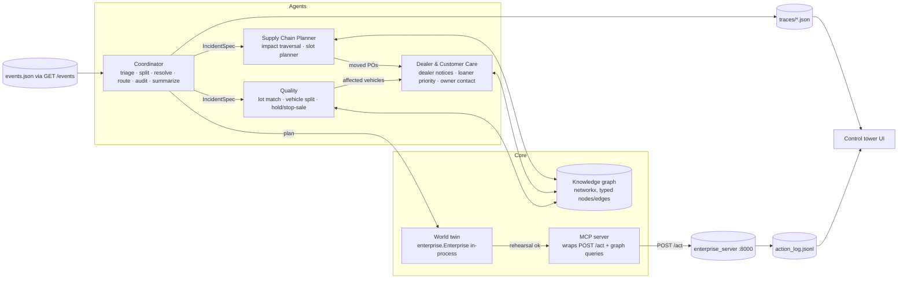

# PLAN — Hack the Highway control tower

Companion to `SPEC.md` (what) — this is the how, the differentiator, the schedule, and the agent-first dev setup.

---

## 1. Strategy: where the points are

- 50% of the score is a **replay of our action log**. Wrong or extra actions cost; failed calls cost. So the
  action set must be computed deterministically from the handbook rules, and must be rehearsed before it is sent.
- The LLM is needed for exactly one hard thing: turning messy human text into a typed `IncidentSpec`
  (category, entities, dates, confidence). Everything downstream is graph traversal + arithmetic.
- The remaining 50% is judged by humans reading our architecture, graph, traces and UI. Those must be
  legible: one page of roles, one ontology diagram, one path per event, one reason per event.

Design principle: **LLM decides what happened; code decides what to do; a twin proves it works; then we act.**

## 2. Architecture



### Per-event data flow
1. **Ingest**: coordinator fetches the event, snapshots a fresh twin.
2. **Understand (LLM)**: structured-output call → `IncidentSpec[]` with raw mentions, resolved ids (via alias table passed in the prompt), ISO dates (LLM proposes, code recomputes relative dates from 2027-03-08 and compares), confidence, ambiguities.
3. **Validate (code)**: ids exist in graph; dates fall on working days inside the window; shipment dates land on real ETAs; lot windows match a real lot. Any miss → confidence penalty.
4. **Gate**: `noise` → write nothing, record reason. `unconfirmed` or confidence < threshold → `escalate(reason)`.
5. **Impact (code via graph)**: specialist traverses and returns affected records **with paths**.
6. **Plan (code)**: specialists emit an ordered `Action[]`, sharing one `WorldState` (slots, pools) within the event.
7. **Rehearse (twin)**: run the full plan against the in-process `Enterprise`; any `ToolError` → plan rejected → escalate with details. Also assert invariants (≥3 action kinds for real incidents, exactly one notify per dealer, no unaffected ids).
8. **Audit (LLM, cheap)**: coordinator asks a small model to check the plan summary against the handbook rules ("anything here violates a rule?"). Disagreement → escalate, do not act. (Secondary guardrail; the twin is the primary.)
9. **Execute (MCP)**: read tools first (`get_schedule`, `loaner_availability`) for an auditable baseline, then writes in order. Runtime errors are captured, never retried blindly.
10. **Explain (LLM, cheap)**: one-paragraph business summary + "why we did / did not act", stored in the trace with the graph paths.

## 3. LLM vs code (the split judges ask for)

| Step | Owner | Why |
|---|---|---|
| Category, incident splitting, entity mention extraction, confidence, ambiguity list | **LLM** (structured output, schema-validated) | Needs language understanding; messy text, nicknames, multi-incident digests. |
| Alias → id resolution | code (exact → alias table → fuzzy), LLM only as tie-breaker | Deterministic and auditable. |
| Relative date resolution | code (rule-based from 2027-03-08) with LLM's reading as a cross-check | Dates decide which POs move; must be exact. |
| Graph traversal, affected sets, slot planner, loaner priority, vehicle split | **code** | Handbook is explicit; replay grading is exact. |
| Plan rehearsal, invariants, failed-call handling | code (twin) | Zero failed calls. |
| Pre-commit audit, final summary, escalation reason wording | **LLM** (small model) | Human-readable explainability; second opinion. |
| Notification message text | templates (optional LLM polish behind a flag) | Deterministic, cheap. |

Expected LLM calls per event: 2–3 (understand, audit, summarize). ~40 calls per full run.

## 4. Agents and responsibilities

| Agent | Responsibility | Tools it may use | Must not |
|---|---|---|---|
| **Coordinator** | Triage, split compound messages, resolve entities/dates, gate on confidence, own the shared `WorldState`, dispatch to specialists, rehearse, audit, execute, summarize, escalate. | LLM, graph lookup, twin, MCP execute, `escalate` | Compute impact itself. |
| **Supply Chain Planner** | Supplier delay & plant outage impact (Shipment/Plant → PO), earliest-feasible-slot planning, transfers. | graph traversal, `mes.get_schedule`, planner | Touch dealers/customers. |
| **Dealer & Customer Care** | From moved POs → affected COs → one notice per dealer, loaner priority & pool limits; owner contact for quality incidents. | graph traversal, `crm.loaner_availability`, `dealer.notify`, `crm.assign_loaner`, `crm.notify_customer` | Move orders. |
| **Quality** | Lot identification from (part, plant, window), affected vehicle set, sold/unsold split, `quality.hold_lot`, `dealer.stop_sale`; hands owners to Care. | graph traversal, `quality.hold_lot`, `dealer.stop_sale` | Notify customers directly. |

Each specialist is an object with `analyze(spec, world) -> Impact(with paths)` and `plan(impact, world) -> Action[]`,
plus a short LLM step that narrates its reasoning for the trace. The deterministic core is unit-tested without an LLM.

## 5. The cherry on top

Most teams will build "LLM agent calls tools in a loop". It will produce failed calls, touched-but-unaffected
records, and inconsistent compound handling. Our headline:

> **The control tower never takes an action it has not already rehearsed successfully on a digital twin, and it shows the judge the rehearsal, the counterfactual, and its own robustness score.**

Concretely, five things, in priority order:

1. **Digital-twin pre-flight.** We import the organizers' own `enterprise.Enterprise` and run every plan in-process
   before a single `POST /act`. Result: zero failed calls, exact slot/loaner contention handling in compound events,
   and a "rehearsal passed ✔" badge per event. Cheap to build (the class already exists), hugely effective on the
   50% + 10% efficiency criteria.
2. **Data-grounded understanding.** Every date and entity the LLM extracts is snapped to the data (real shipment
   ETAs, real lot windows, real plant/model combinations). A mismatch is not silently fixed; it lowers confidence and
   can trigger escalation with a precise question for the human ("Did you mean SH-0190 due Mar 15, or SH-0191 due Mar 22?").
   This is what makes "next Friday" safe.
3. **Two-channel verification before acting.** Deterministic planner + independent LLM auditor reading the handbook.
   Act only when both agree; otherwise escalate. Clean story for the guardrails criterion and for human-in-the-loop.
4. **Blast-radius & counterfactual view.** For each incident the UI shows the ripple as a highlighted subgraph
   (Shipment → Part → Models → POs → COs → Dealers/Customers), plus "what we prevented": promised-date slips per
   customer, loaners issued vs. entitled, vehicles pulled from sale vs. owners contacted. Business-friendly and
   directly uses the graph.
5. **Self-evaluation harness we can show.** (a) A replay grader that re-runs `action_log.jsonl` on a fresh twin and
   diffs against the deterministic oracle; (b) a **paraphrase stress test**: generate ~100 rewordings of the 15 events
   (different nicknames, date phrasings, digest formats) and report classification/extraction accuracy. Judges review
   code; a test suite that proves robustness is rare in a 24-hour build.

Stretch (only if time allows): **offline mode** with a small local model (Ollama) for extraction, with Haiku as fallback,
so the whole tower runs with no internet — matches the brief's "no cloud required" spirit and the efficiency rubric.

## 6. Tech stack and decisions

| Layer | Choice | Why |
|---|---|---|
| Language | Python 3.12 (`.python-version` says 3.12; machine has 3.14 — pin 3.12 via `uv`) | Organizers' code is Python; team speed. |
| Package mgmt | `uv` (already installed) | Fast, lockfile. |
| Graph | `networkx` (+ `rdflib` Turtle export of the ontology as a nice-to-have) | Zero infra, path queries, GraphML export. |
| LLM | Provider-agnostic `llm/adapter.py` (`complete_json(schema, …)`), JSON-schema structured output, usage logging. **Primary now: Gemini (Flash-class) via the key we already have.** Optional second backend: Anthropic **Claude Haiku 5.5** (`claude-haiku-5-5`) / **Sonnet 5.5** for fallback and a model comparison in the design card. Local Ollama backend only if needed. | Zero spend to start; small model wins efficiency points; adapter lets us cite whichever model scores best on the paraphrase bench. ~40 calls/run. |
| MCP | Python `mcp` package (FastMCP) server exposing `enterprise_*` action tools and `graph_*` query tools over stdio; in-process MCP client in the orchestrator; the same server registered in `.mcp.json` for Claude Code. | Satisfies "MCP-style", teaches MCP, doubles as a dev tool. |
| Orchestration | Hand-rolled coordinator (plain Python classes), no heavy framework | Full control of traces and determinism; nothing to debug at 3am. |
| Twin | `from enterprise import Enterprise` | Already written by organizers. |
| UI | **Vite + React 18 + TypeScript**, Tailwind v4 + shadcn/ui (dark ops-center theme using the Hitachi-inspired tokens in `BRAND.md`), **React Flow (@xyflow/react) + ELK layout** for graph paths with collapsible group nodes, Recharts for KPIs/counterfactuals, TanStack Query + SSE (`EventSource`) for the live feed, Framer Motion for feed animation. Backend: **FastAPI** serving traces/log + `sse-starlette` stream; pipeline runs as a background task started from the UI. | Looks like a real product; React Flow renders highlighted paths and grouped nodes far better than Streamlit components; SSE gives the "events arriving live" demo. Streamlit rejected on look; Next.js rejected as unnecessary. |
| Tests | `pytest`; planner unit tests use the twin and the CSVs, no LLM; LLM tests record/replay fixtures | Deterministic CI in a hackathon. |

### Decisions (made 2026-11-07)
1. **Runtime LLM**: cloud first through a provider-agnostic adapter. Start with the existing Gemini key (no purchase needed); the Anthropic API is billed separately from the Max plan, so add a Haiku 5.5 key only if we want the comparison. Local Ollama only if needed.
2. **UI**: React stack above. Must look like a real company product.
3. **Team**: two people with code names. **CORE** (you, Fable/Max) owns everything that changes the action log; **GLASS** (teammate, Pro) owns UI, API, MCP wrapper, evaluation reports, docs, video. Ownership enforced via `.claude/rules/ownership.md`, `CODEOWNERS` and each person's `CLAUDE.local.md`. Granular board in `WORKPLAN.md`.

## 7. Repository layout (proposed, not created yet)

```
hack_the_highway/
  CLAUDE.md                      # project memory for Claude Code (agent-first, see §9)
  .claude/agents/*.md            # architect, implementer, reviewer, data-detective, eval-runner
  .claude/skills/*/SKILL.md      # /run-events, /grade, /trace, /data-query
  .claude/rules/*.md             # path-scoped rules (planner = handbook is law; agents = LLM boundaries)
  .mcp.json                      # wacky-enterprise + knowledge-graph MCP servers for Claude Code
  pyproject.toml                 # uv project
  src/control_tower/
    data/loader.py               # CSV → dataclasses
    graph/ontology.py            # node/edge types, build(), traversals returning paths, export()
    understanding/schemas.py     # IncidentSpec (Pydantic), categories
    understanding/extract.py     # LLM structured extraction
    understanding/resolve.py     # aliases, fuzzy, relative dates, data snapping, confidence
    agents/coordinator.py        # triage, gate, dispatch, rehearse, audit, execute, summarize
    agents/supply_chain.py       # impact + slot planner
    agents/dealer_care.py        # notices, loaners, owner contact
    agents/quality.py            # lot, vehicles, hold/stop-sale
    world/twin.py                # wraps enterprise.Enterprise for rehearsal + invariants
    mcp/server.py                # FastMCP: enterprise_* and graph_* tools
    mcp/client.py                # in-process MCP client used by the executor
    trace.py                     # trace schema + writer
    run.py                       # CLI: run all events / one event / dry-run
  eval/
    oracle.py                    # deterministic expected-actions from rules (for self-grading)
    replay_grader.py             # replays action_log.jsonl on a fresh twin, diffs vs oracle
    paraphrase_bench.py          # generates reworded events, measures extraction accuracy
  api/app.py                     # FastAPI: traces, actions, graph, kpis, SSE stream, run trigger
  ui/                            # Vite + React + TS control tower (src/components, src/pages, src/lib/api.ts)
  docs/                          # SPEC.md, PLAN.md, CONCEPTS.md, design_card.md, ontology.md
  runs/, traces/                 # outputs (gitignored except final)
```

## 8. Schedule

See `WORKPLAN.md` for the two-person task board, hour-by-hour plan, AI-budget playbook and sync agenda.

## 9. Agent-first development workspace (Claude Code in VS Code)

Verified against current Claude Code docs: project subagents live in `.claude/agents/*.md` with frontmatter
`name`, `description`, `tools`, `model` (`sonnet|opus|haiku|fable|inherit|<full id>`), `effort`, `permissionMode`,
`maxTurns`, `skills`, `mcpServers`; skills live in `.claude/skills/<name>/SKILL.md` (commands are legacy); path-scoped
rules in `.claude/rules/*.md` with `paths:`; project MCP servers in `.mcp.json` (`mcpServers` → `command`/`args` for stdio);
hooks in `.claude/settings.json`. Plan mode via Shift+Tab or `--permission-mode plan`; `/model fable`, `/effort`.

### 9.1 Roles → models
| Role | File | Model / effort | Permission | Job |
|---|---|---|---|---|
| Architect | `.claude/agents/architect.md` | `fable`, `effort: high` | `plan` (read-only + Bash for analysis) | Turn a SPEC section into a step list with files, interfaces, tests. Never edits. |
| Implementer | `.claude/agents/implementer.md` | `sonnet`, `effort: medium` | `acceptEdits` | Implements one step at a time; runs `pytest`; stops at the step boundary. |
| Reviewer | `.claude/agents/reviewer.md` | `opus`, `effort: high` | read-only | Adversarial review of a diff against SPEC §5 and §7; outputs findings, no edits. |
| Data detective | `.claude/agents/data-detective.md` | `sonnet` | Bash (python, read-only) | Answers "how many POs would X affect" style questions from the CSVs; used to verify planner output. |
| Eval runner | `.claude/agents/eval-runner.md` | `haiku`, `effort: low` | Bash | Starts server, runs all events, runs grader, reports diff table. Cheap, repeatable. |
| Second opinion | Opus `reviewer` subagent (no ChatGPT on the team, so no Codex) | — | — | Independent review of risky diffs (planner, resolver). |

Workflow per feature: CORE + Fable in **plan mode** → `architect` writes the step plan into `docs/tasks/<feature>.md` →
`implementer` executes steps → `eval-runner` reports → `reviewer` reviews → CORE merges. GLASS runs the same loop on Sonnet for `ui/` and `api/`. The main session
stays on Fable for judgement calls; cheap models do the volume.

### 9.2 Files
- `CLAUDE.local.md` (gitignored, per machine): `You are assisting CORE|GLASS.` plus the ownership rule — this is how each person's assistant knows which tasks and paths are theirs.
- `.claude/rules/ownership.md`: path → owner table from WORKPLAN §0; "do not edit paths you don't own; write a request in docs/handoff/".
- `CLAUDE.md` (project root): goal in 5 lines; "handbook is law, never hard-code answers, planner must be deterministic and
  LLM-free"; run commands; where traces/logs live; link to SPEC/PLAN.
- `.claude/rules/planner.md` (`paths: src/control_tower/agents/**, src/control_tower/graph/**`): rules 1–10 verbatim; "no LLM imports here".
- `.claude/rules/llm.md` (`paths: src/control_tower/understanding/**`): structured outputs only; model ids; token logging mandatory.
- `.claude/skills/run-events/SKILL.md`: start server on a fresh `--out`, run pipeline, print summary table.
- `.claude/skills/grade/SKILL.md`: run `eval/replay_grader.py`, print diff.
- `.claude/skills/trace/SKILL.md` (`argument-hint: <event_id>`): pretty-print one trace.
- `.mcp.json`: `wacky-enterprise` → `uv run python -m control_tower.mcp.server` (stdio). Lets Claude Code call `graph_impact(...)` or `enterprise_get_schedule(...)` while you debug — the same server the runtime agents use.
- `.claude/settings.json` hooks: `PostToolUse` on `Edit|Write` → `uv run ruff check --fix` and `uv run pytest -q tests/unit -x` (fast tests only).

### 9.3 Cost hygiene for the dev loop
Main session Fable at `high` only for planning and tricky debugging; `/effort medium` for routine work; implementer on Sonnet;
eval runner on Haiku. Runtime LLM (Gemini or Haiku via API key) is separate from dev LLM (your Max plan).

## 10. Risks

| Risk | Mitigation |
|---|---|
| Slot-ordering ambiguity (A1/A2) makes our moves differ from the grader's expected slots | Single configurable policy; document choice; replay grader shows sensitivity; both orderings produce a valid feasible schedule. |
| LLM misreads a relative date | Code recomputes from rules; snap to real ETA/lot; disagreement ⇒ escalate, not act. |
| Quality events generate ~190 write calls each; slow or rate-limited | Pure code, batched by dealer; server is local; no LLM per action. |
| Over-escalation (hurts accuracy on real incidents) | Confidence threshold tuned on the 15 events + paraphrase bench; clean structured events must score ~1.0. |
| Running out of time on UI | React shell + feed + summary tab against example traces by hour 5; every later panel is additive. |
| API key / quota hiccup at demo time (Gemini free tier is rate-limited) | Cache LLM outputs per event text hash; `--replay-llm` flag runs the whole pipeline from cached extractions; adapter can switch provider with one env var. |

## 11. Immediate next steps (when you say go)
1. Confirm the three decisions in §6.
2. Scaffold: `uv` project, `CLAUDE.md`, `.claude/agents`, `.claude/skills`, `.mcp.json`, `pyproject` deps (`anthropic`, `mcp`, `networkx`, `pydantic`, `streamlit`, `pytest`, `ruff`).
3. Hour-1 spike: load CSVs → graph → `impact(E-12)` printed with paths → rehearsed on the twin → 0 errors. That spike de-risks the whole design.
